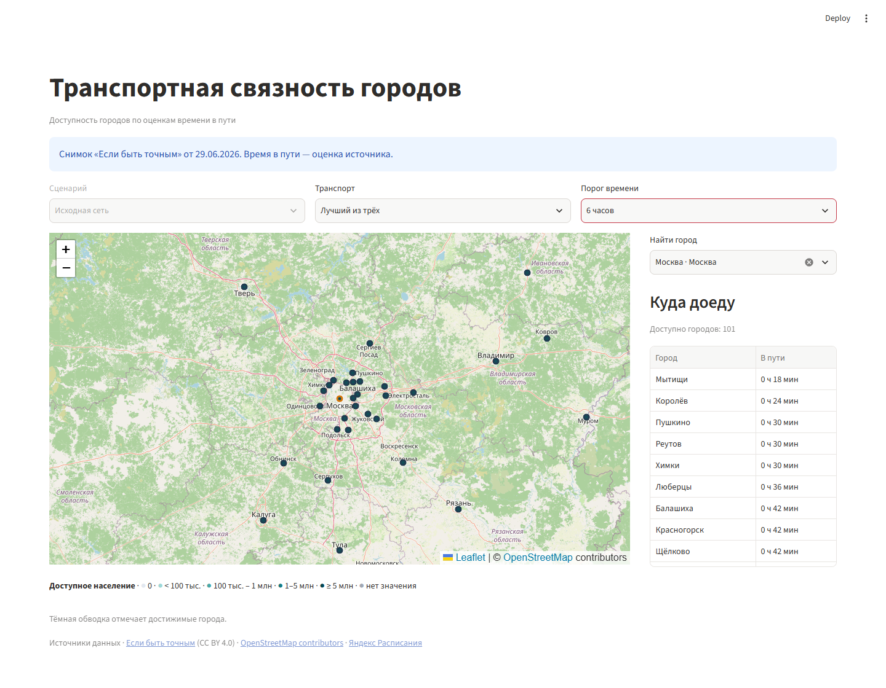

# Transport Connectivity

Исследуем транспортную связность 180 городов России. Сколько городов и жителей
доступно за 3, 6 и 24 часа? Через какие города проходят маршруты в модели?
Как меняется доступность при удалении узла или добавлении связи?

## Данные и методика

| Источник | Что используем |
|---|---|
| «Если быть точным», снимок 20260629 | 96 660 измерений времени и расстояния для направленных пар городов и трёх видов транспорта |
| Яндекс Расписания, дата поездки 1 декабря 2026 года | Наблюдения прямых рейсов для отдельного анализа покрытия и связности |
| OpenStreetMap и OSRM | Города и расчёт автомобильных маршрутов в пилоте |

Команда `process` проверяет контрольные суммы и баланс строк, сопоставляет
города по внешним идентификаторам и приводит расстояния и время к метрам и
секундам. Для карты слой «Лучший из трёх» выбирает минимальное время для каждой
пары, добавляя к авиационному времени 3 часа. Доступное население — сумма
населения других городов, укладывающихся в выбранный порог.

Для оценки устойчивости нужна отдельная модель связей. Запись матрицы описывает
поездку между городами, которая может проходить через другие узлы. Методика
прореживания обсуждается в [PR #40](https://github.com/AlexKeyyyy/transport-connectivity/pull/40).
[Контракт данных](docs/data-contract.md) · [Ограничения источников](docs/constraints.md)

## От данных к результату

```text
Снимок источника → download → CSV и manifest → process → нормализованные CSV
                                                          ├─→ load → PostgreSQL/PostGIS
                                                          └─→ экспорт JSON → карта Streamlit
                                     migrate → схема PostgreSQL/PostGIS ↗
```

PostgreSQL/PostGIS хранит нормализованные данные и аналитические таблицы.
Карта запускается по выгрузке JSON. Neo4j и Elasticsearch предусмотрены как
производные представления. [Архитектура и схема компонентов](docs/architecture.md)

## Воспроизвести проверенный сценарий

Нужны Git, Python 3.12+, Docker с Compose и интернет для первого скачивания
данных и зависимостей. Команды ниже для PowerShell, из корня свежего checkout
этой ветки. Для локального контейнера указан порт 55437. Если он занят,
выберите свободный порт.

```powershell
python -m venv .venv
.venv\Scripts\Activate.ps1
python -m pip install -e ".[dev,app]"

python -m transport_connectivity.cli download
python -m transport_connectivity.cli process

$env:POSTGRES_HOST = "127.0.0.1"
$env:POSTGRES_PORT = "55437"
$env:POSTGRES_DB = "transport_connectivity"
$env:POSTGRES_USER = "postgres"
$env:POSTGRES_PASSWORD = "postgres"
docker compose -p transport-defense up -d --wait postgres
python -m transport_connectivity.cli migrate
python -m transport_connectivity.cli load
python -m transport_connectivity.cli load

python scripts/dev/export_map_accessibility.py
python scripts/dev/check.py
python -m streamlit run src/transport_connectivity/app/map_app.py
```

В Linux/macOS активируйте окружение через `source .venv/bin/activate`, а переменные
задайте через `export`. Если PowerShell блокирует активацию, вызовите
`.venv\Scripts\python.exe` вместо `python` в последующих командах. После остановки
Streamlit контейнер можно остановить командой `docker compose -p transport-defense stop`.

## Контрольные результаты

| Проверка | Результат | Доказательство |
|---|---|---|
| Нормализация полного снимка | 180 городов, 96 660 измерений, 0 отклонённых строк | [Отчёт прогона](deliverables/interim/evidence/processing-run-1.json) |
| Первая и повторная загрузка в PostGIS | 180 городов, 360 внешних ID, 96 660 измерений, один запуск загрузки в базе | [Прогон и контрольный SQL](benchmarks/README.md) |
| Карта, Москва, «Лучший из трёх», 6 часов | 101 достижимый город по матрице времени | [Проверка карты](docs/map.md) |
| Авиаграф Яндекс Расписаний на 1 декабря | 482 ребра. При удалении Москвы число достижимых направленных пар среди остальных городов снизилось с 4 900 до 3 660 | [Эксперимент](deliverables/predefense/yandex-air-resilience.md) и [покрытие](deliverables/predefense/yandex-air-coverage.md) |



Для карты выберите Москву через поиск, слой «Лучший из трёх» и порог 6 часов.
Данные читаются из местного JSON. Для фоновой подложки OpenStreetMap нужен
интернет. Для оценки стыковок по расписанию используйте отдельный авиационный
пример из материалов защиты.

## Где что находится

| Каталог | Содержание |
|---|---|
| [`src/transport_connectivity/`](src/transport_connectivity/) | CLI, загрузка, обработка, PostgreSQL и карта |
| [`data/`](data/README.md) | Получение снимков, схема каталогов и контрольные запросы |
| [`docs/`](docs/README.md) | Модель данных, диаграммы, ограничения и план |
| [`tests/`](tests/) | Проверки преобразований, схемы и карты |
| [`benchmarks/`](benchmarks/README.md) | Замеры времени и памяти |
| [`deliverables/`](deliverables/interim/README.md) | Отчёты, материалы и доказательства запусков |

Алексей собирает материалы и проверяет устойчивость, Лина отвечает за методику
графа, Елисей — за хранение и доступность, Мадина — за Neo4j и поиск, Ранис — за
карту. [Чек-лист финальной защиты и задачи команды](docs/defense-checklist.md)

## Как работаем

| Ветка | От чего | Куда вливается | Назначение |
|---|---|---|---|
| `main` | — | — | Выпуски с тегами |
| `develop` | — | — | Интеграция задач |
| `feature/<issue>-<short>` | `develop` | `develop` | Одна задача |
| `release/<version>` | `develop` | `main`, затем `develop` | Подготовка выпуска |
| `hotfix/<issue>-<short>` | `main` | `main` и `develop` | Срочное исправление выпуска |

Задача проходит проверки, рецензирование и squash merge через PR. Правила
проекта описаны в [AGENTS.md](AGENTS.md), рабочий цикл — в [документации
harness](docs/harness.md). PDF планируем отправить 28–29 ноября. Финальная
защита — 4 декабря 2026 года.