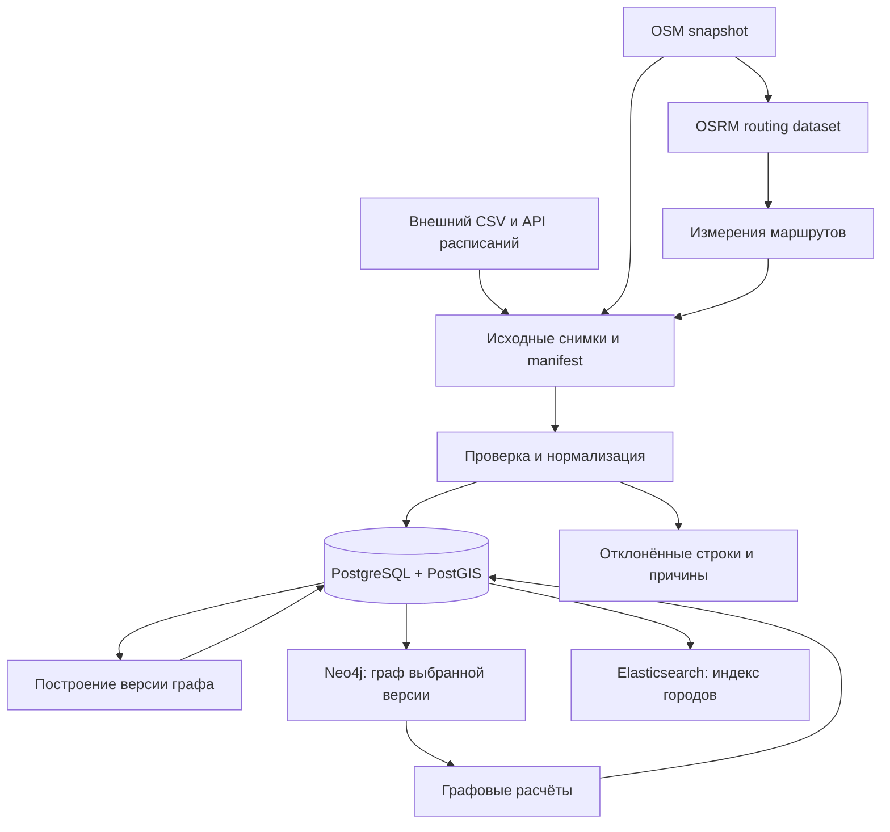

# Архитектура

Статус: проектная основа. Сейчас реализованы загрузка и профилирование пилота.
Сервисы и модули ниже добавляются по соответствующим Issues.

## Форма приложения

Один Python-пакет с модулями по задачам предметной области. Загрузка и расчёты
запускаются последовательно из CLI. PostgreSQL/PostGIS хранит нормализованные
данные и результаты. Neo4j и Elasticsearch получают производные представления.

| Модуль | Ответственность |
|---|---|
| ingestion | Получить исходный снимок; сохранить файл, источник, дату и контрольную сумму |
| normalization | Проверить поля, сопоставить ID, привести единицы, учесть отклонения |
| db | Схема, миграции и запросы PostgreSQL/PostGIS |
| graph | По документированной методике построить GraphSnapshot и GraphEdge |
| analysis | Рассчитать показатели и сравнить сценарии на заданной версии графа |
| projections | Выгрузить выбранную версию данных в Neo4j и Elasticsearch |
| cli | Разобрать аргументы и вызвать нужный этап |

Это границы ответственности, а не требование немедленно создать каталоги.
Существующие scripts остаются точками запуска; общая логика переносится в пакет
при работе над соответствующей задачей. Конфигурация общая и небольшая.

Вычисления работают с явными входами и параметрами; не читают environment variables
и не выполняют HTTP/SQL сами. Обращения к файлам, API и БД остаются на границах.
CLI собирает этапы вместе. Класс, интерфейс или дополнительный слой появляется,
когда решает конкретную проблему; общей иерархии сервисов заранее нет.

## Потоки данных

У публичного OSRM в пилоте версия дорожного графа неизвестна. Для воспроизводимого
self-hosted OSRM нужны закреплённые OSM snapshot, профиль и параметры сборки.
Исходные большие файлы хранятся вне Git; PostgreSQL хранит их метаданные и ссылки.

## Основное хранилище и проекции

- PostgreSQL/PostGIS — источник истины для нормализованных данных, определений
  графов и сохранённых результатов анализа.
- Neo4j — восстанавливаемая графовая проекция. В проекции известен GraphSnapshot;
  результаты вычислений записываются обратно с идентификатором AnalysisRun.
- Elasticsearch — восстанавливаемый индекс городов. Его доступность не влияет
  на корректность загрузки и аналитики.
- Проекции обновляются отдельной командой после успешной загрузки. Частично
  собранная версия не объявляется готовой. Удаление проекции не теряет первичные данные.

## Смысл данных и графа

City имеет внутренний ID; внешние идентификаторы хранятся с указанием источника.
Название города не является ключом. Неоднозначные сопоставления учитываются явно.
Для каждого набора определяются единицы, CRS, допустимые пропуски и ключ записи.

RouteMeasurement описывает измеренную/оценённую поездку A → B. Оно не доказывает
непосредственную связь городов в транспортной сети. GraphEdge появляется только
по выбранной методике и относится к конкретному GraphSnapshot.

Матрица времени поездки подходит для оценки доступности. Для анализа устойчивости
нужна модель непосредственных связей или явная модель зависимостей маршрутов:
удаление одного измерения из матрицы не моделирует закрытие реальной дороги.
Сначала документируем смысл вершины, ребра, направления, веса и сценария, затем
реализуем алгоритмы. Измерения разных видов транспорта не смешиваем без правила.

GraphSnapshot ссылается на все использованные снимки, версию методики и параметры.
AnalysisRun ссылается на GraphSnapshot, алгоритм, параметры и версию кода.
Расписания сохраняют дату поездки и часовой пояс. «Не запрашивали», «ошибка
источника» и «маршрут отсутствует» — разные состояния.

## Надёжность и проверка

1. Исходный файл проверяется до использования; manifest содержит источник,
   версию, SHA-256 и фактический объём.
2. Повторный запуск на том же входе не создаёт дубликаты и даёт тот же результат
   данных; служебные времена запуска могут различаться.
3. Невалидные строки учитываются с причиной; допустимые пропуски сохраняются.
4. Частичный или неуспешный запуск не публикуется как успешный набор.
5. Отчёт запуска содержит вход, выход, отклонения, дубликаты, время и память;
   число входных строк полностью объясняется выходом и исключениями.
6. Ограничения PK/FK/UNIQUE/CHECK закрепляются в БД при реализации схемы.
   Offline-тесты проверяют преобразования; интеграционные — реальную БД и миграции.

## Порядок реализации

Модель и контракт → полный CSV и обработчик → PostgreSQL/PostGIS → методика
и версия графа → Neo4j и аналитика → поиск и демонстрация.
Исследование ограничений и подготовка отчёта идут параллельно.

Полная ingestion OSM, self-hosted OSRM, API и UI получают отдельные Issues.
Для текущего объёма начинаем с последовательного запуска. Очереди, распределённые
вычисления, отдельные микросервисы и абстрактные адаптеры требуют измеренной
потребности. Важные изменения решений фиксируем в ADR при их принятии.
