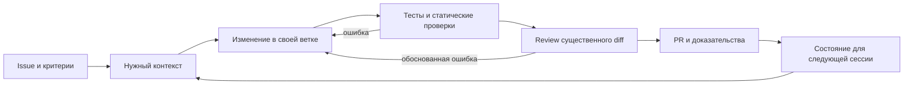

# Рабочее окружение агента

Для этого проекта harness — набор версионируемых правил, инструкций и исполняемых
проверок вокруг coding-агента. Собственный runtime или оркестратор здесь не нужен.

## Система и её обратная связь

| Часть harness | Где живёт | Как проверяем |
|---|---|---|
| Намерение и границы | Issue: цель, результат, Acceptance Criteria, зависимости | Каждый критерий сопоставлен с доказательством в PR |
| Контекст по необходимости | AGENTS.md → нужный docs/контракт → выбранный skill | Локальные ссылки, версия источника, отсутствие копий противоречащих правил |
| Исполнение и изоляция | Ветка/worktree, один владелец общего файла, роль субагента | Git diff и явные границы делегированной работы |
| Обратная связь | Фокусные тесты в процессе; общий check перед сдачей | Exit codes, логи; полному прогону нужен отдельный run-report |
| Независимая оценка | transport_reviewer и человек, принимающий PR | Конкретные сценарии и последствия замечаний, проверка после исправления |
| Продолжение и восстановление | Git + Issue/PR; при сложной долгой задаче один связанный план | Следующий участник видит commit, выполненное, оставшийся шаг и непроверенное |

Агент сначала формулирует короткий контракт изменения: вход, выход, ограничение
scope и способ проверки. Обычно достаточно Issue; не создаём отдельный документ
для каждого маленького исправления. Если новая информация меняет контракт,
сначала обновляем его и затронутых потребителей.

В процессе изменения запускаются относящиеся тесты. После review и исправлений
выполняется итоговый `python scripts/dev/check.py`; последующий значимый diff
требует новой проверки затронутого поведения. Не повторяем неизменённые команды
без новой гипотезы, кроме обоснованного transient-сбоя.

При внешнем блокере записываем точную ошибку и непроверенную часть, продолжаем
независимую работу. Частичный dataset/индекс не выдаётся за готовый. При передаче
оставляем ветку/commit, последнюю команду и результат, оставшийся шаг и блокировку.
План и состояние задачи не должны существовать только в памяти чата.

Повторяющуюся ошибку превращаем в конкретный regression test, улучшение инструмента
или узкую правку инструкции. Обновление harness оцениваем на примерах из
[harness-evals](harness-evals.md), а не по числу добавленных правил.

## Как распределять работу

Для небольшой задачи достаточно основного агента. Для отдельного неизвестного
используется `transport_investigator`, для независимого анализа существенного diff —
`transport_reviewer`. В `.codex/agents/` лежат две роли, в `.codex/config.toml` —
лимит двух одновременно открытых субагентов. Модель и права наследуются.

Исследователю передают конкретный вопрос и границы. Ревьюеру — задачу, diff и
Acceptance Criteria, без подсказки желаемого вывода. Основной агент проверяет
найденные проблемы, исправляет обоснованные и запускает итоговую проверку.
Замечания без сценария и последствия не превращаются автоматически в новые требования.

Обычный цикл: понять контракт → реализовать минимальное изменение → проверить →
получить независимый review существенного кода → исправить → передать PR человеку.
Правка текста или одно очевидное изменение не требуют отдельного субагента.

Примеры запросов:
- «Попроси transport_investigator найти, где теряются missing_reason; верни факты и файлы».
- «Попроси transport_reviewer проверить diff Issue #8 на единицы, баланс строк и повторный запуск».

По умолчанию один агент пишет код, остальные читают. При независимой параллельной
реализации сначала разделить файлы и результаты. Отдельные ветки вести в отдельных
worktrees; не переключать общую рабочую копию под другим исполнителем. Общие схемы,
миграции и интерфейсы согласовать до кода, назначить одного владельца изменения.
При обнаружении чужого изменения выяснить его назначение вместо автоматического отката.

Роли задают поведение, а не отдельную OS-песочницу: права наследуются. Файлы соответствуют
текущей официальной схеме Codex. Project config загружается для доверенного проекта;
на старом клиенте нужно проверить поддержку. Здесь нет CLI для проверки автоматического
обнаружения ролей, поэтому отдельно проверяются TOML и исполнение самих инструкций.
Настройки sandbox, approvals, моделей и аккаунтов в проекте не переопределяются.

## Что считаем качественным кодом

Реализуем один проверяемый результат. Преобразования отделяем от ввода/вывода,
не вводим универсальные сервисы/репозитории заранее. Ошибки диагностируются на
границах; неожиданные исключения не превращаются в тихой обработке в успешный результат.
Изменение поведения сопровождается содержательным тестом; для исправления бага
предпочтителен пример, воспроизводящий исходную ошибку. Процент покрытия и число
тестов сами по себе не являются критерием качества.

Версии pytest и Ruff закреплены в pyproject.toml; обновляются отдельным PR с
повторной проверкой. Это фиксация прямых инструментов, а не полный dependency lock.
Проверка форматирования выполняется автоматически, исправление — явной командой
`python -m ruff format` с просмотром diff. Типизацию и проверки направлений импортов
усиливаем при появлении соответствующей логики; пустые архитектурные тесты не создаём.
Человеческий review и отсутствие прямой работы в main — правила команды. GitHub
branch protection этим PR не настраивается; CI проверяет, но сам не запрещает merge.

## Что проверяется механически

- Совпадение набора skills и всех их файлов с lock, источники/commit/лицензии.
- Discovery fields name/description, соответствие каталогу, metadata проектных skills.
- Синтаксис TOML, обязательные поля ролей и корректный лимит параллельности;
  неработающие попытки переопределить права родителя в профиле отклоняются.
- Локальные Markdown-ссылки в документации и проектных skills.
- Ruff lint/format и pytest, включая негативные тесты проверки harness и запуск notebook helper.
- Те же команды в GitHub Actions на Linux и Windows с Python 3.12.

Hash проверяет целостность относительно принятого lock, а не доброкачественность
инструкций. Структурная проверка и unit-тесты также не доказывают качество решений
модели: для него нужны реалистичные сценарии и наблюдение результатов.
Исходные vendor-файлы не линтим по стилю проекта; адаптации и происхождение видны в lock.
.gitattributes отключает преобразование концов строк в .agents, чтобы hash не менялся
при checkout на Windows.

## Границы

AGENTS.md — короткая карта и общие правила. Skills — выборочные рабочие процедуры.
Документы — контракты и методика. Тесты — проверка поведения. Issue/PR — состояние
конкретной работы. Одни сведения не нужно копировать во все пять мест.

Не добавляем обязательные подтверждения обычных разрешённых действий, автоматический
merge, рассылку сообщений, фоновые циклы, зависимости или серверы ради самого harness.
Skills не расширяют полномочия пользователя. Без сервиса агент пишет проект и честно
указывает непроведённую интеграционную проверку.

## Что уже доказано и что ещё предстоит

Локально проверяются структура конфигурации, integrity skills и поведение helper-скриптов;
в CI выполняются те же offline-проверки на Linux/Windows. Сценарии решений агента
проверяются отдельно. Автоматическое обнаружение custom roles конкретным клиентом
не заменяется проверкой TOML; этот клиентский smoke-check выполняет пользователь
после загрузки project config. Работа будущих PostgreSQL/GDS/ES требует интеграционных
тестов при реализации этих этапов. Это остаётся отдельным от качества инструкций.

Новые слои harness добавляются по наблюдаемой проблеме: typecheck — вместе с
типизированной прикладной логикой; import boundaries — когда есть реальные модули;
полный повторный прогон — при появлении обработчика. Не вводим vacuous-проверки
ради зелёного статуса. Основной критерий: новый участник способен воспроизвести
результат Issue и объяснить доказательства, не читая всю историю чата.

## Изученные источники

Решения выше адаптированы к размеру нашего проекта:

- [OpenAI: Harness engineering](https://openai.com/index/harness-engineering/):
  короткая карта контекста, знания в репозитории и проверяемые ограничения.
- [Anthropic: Effective harnesses](https://www.anthropic.com/research/effective-harnesses-for-long-running-agents):
  последовательный прогресс и ясная передача состояния между сессиями.
- [OpenAI: Skills в OSS](https://developers.openai.com/blog/skills-agents-sdk):
  узкие повторяемые workflows и исполняемые проверки по условию задачи.
- [Anthropic: Context engineering](https://www.anthropic.com/research/effective-context-engineering-for-ai-agents):
  выбор релевантного контекста вместо постоянной загрузки всей базы правил.
- [Anthropic: Evals](https://www.anthropic.com/engineering/demystifying-evals-for-ai-agents):
  оценка наблюдаемого результата, а не только формы ответа агента.
- [OpenAI Agents SDK: AGENTS.md](https://github.com/openai/openai-agents-python/blob/main/AGENTS.md)
  и [verification skill](https://github.com/openai/openai-agents-python/tree/main/.agents/skills/code-change-verification):
  применимость проверок по diff, focused-проверки и финальный общий проход.
- [Anthropic autonomous-coding example](https://github.com/anthropics/claude-quickstarts/tree/main/autonomous-coding):
  изучены исполнение сессий и сохранение состояния. Это demo с другим продуктом;
  его бесконечный цикл, 200 feature-checks и автоматические повторы не перенесены.
- [Codex: custom subagents](https://learn.chatgpt.com/docs/agent-configuration/subagents):
  формат ролей, наследование и лимит параллельности.
- [Codex: обнаружение repo skills](https://learn.chatgpt.com/docs/build-skills):
  каталог `.agents/skills`, выбор по описанию и явное обращение `$skill-name`.
