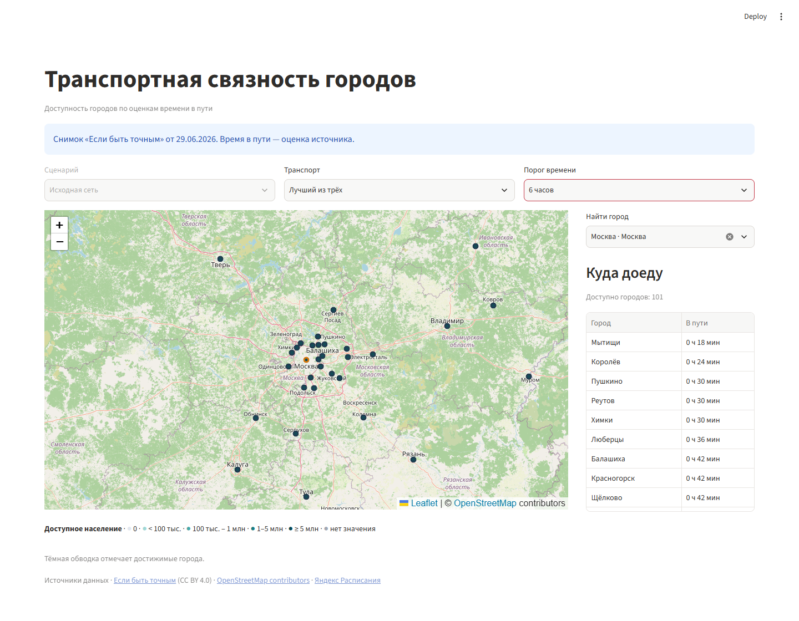

# Интерактивная карта

По умолчанию карта читает готовую выгрузку доступности по снимку «Если быть точным» от 29 июня 2026 года. На карте 180 городов. Цвет показывает население, доступное за выбранное время, а поиск по городу открывает список достижимых городов с оценкой времени поездки.

## Запуск

Из корня репозитория в окружении Python 3.12+:

```powershell
python -m pip install -e ".[app]"
python -m streamlit run src/transport_connectivity/app/map_app.py
```

Если файл `data/normalized/map_accessibility.json` уже подготовлен, карта сразу откроется. Его можно собрать из закреплённого снимка:

```powershell
python -m transport_connectivity.cli download
python -m transport_connectivity.cli process
python scripts/dev/export_map_accessibility.py
```

Для подложки OpenStreetMap браузеру нужен доступ в интернет. Приложение читает сохранённую выгрузку. Расчёт выполняется отдельной командой до запуска карты.

## Проверка на Москве

В поиске выберите Москву, оставьте «Лучший из трёх» и установите порог 6 часов. Справа будет **101 достижимый город**. «Лучший из трёх» берёт минимальное время для каждой пары городов. Для авиации добавлено три часа. Длительность в исходной матрице представляет оценку времени поездки.




## Режимы и зависимости

- `-- --source offline` загружает готовые оценки времени и доступного населения. Поиск идёт по локальному списку. Размер точек одинаковый, переключатель сценариев отключён до появления результатов.
- `-- --source sample` показывает явно помеченные демонстрационные значения посредничества и сценарии «Без Москвы» и «С ВСМ Москва — Санкт-Петербург».
- Для `--source db` нужны [таблицы #32](https://github.com/AlexKeyyyy/transport-connectivity/issues/32), [доступность #33](https://github.com/AlexKeyyyy/transport-connectivity/issues/33) и [устойчивость #35](https://github.com/AlexKeyyyy/transport-connectivity/issues/35). Для поиска с опечатками нужен [#30](https://github.com/AlexKeyyyy/transport-connectivity/issues/30).
