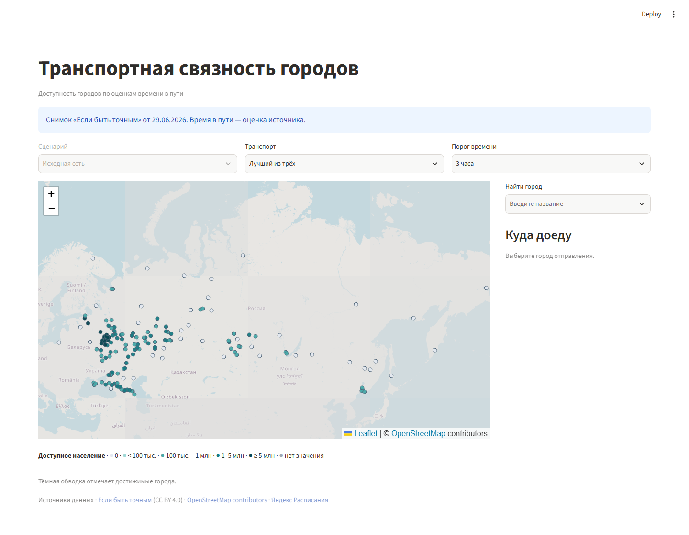

# Интерактивная карта

Карта показывает доступное население и города в пределах выбранного времени.
В режиме PostgreSQL размер точек показывает посредничество, когда готов
расчёт #35. Выбор города открывает список направлений с оценкой времени.
Исходные данные охватывают 180 городов и закреплены снимком от 29 июня 2026 года.

## Запуск с PostgreSQL

Из корня репозитория в окружении Python 3.12+ выполните команды.
Настройки PostgreSQL и порядок загрузки описаны в [инструкции по данным](../data/README.md).

```powershell
python -m pip install -e ".[app]"
python -m transport_connectivity.cli accessibility --include-air
python -m streamlit run src/transport_connectivity/app/map_app.py -- --source db
```

Карта читает готовые результаты из PostgreSQL. Команда `accessibility`
с флагом `--include-air` добавляет отдельный слой самолёта с той же
трёхчасовой поправкой, что и в слое «Лучший из трёх». Обычный запуск
команды сохраняет три слоя #33. При другом снимке измените `MAP_SNAPSHOT_ID`
и передайте его команде `accessibility` как `--snapshot-id`.

Посредничество и сценарии «Без Москвы» и «С ВСМ Москва — Санкт-Петербург»
появляются после публикации расчётов [#35](https://github.com/AlexKeyyyy/transport-connectivity/issues/35).
Карта берёт их из одной готовой версии `best`, α = 0,05. Цвет показывает
изменение доступного населения относительно этой версии графа. Время
в списке направлений по-прежнему берётся из исходной матрицы.

Для поиска по названию с опечаткой укажите `ELASTICSEARCH_URL` и
подготовьте индекс с алиасом `cities`, как описано в
[контракте поиска](elasticsearch.md). Карта использует `search_cities`
из [#30](https://github.com/AlexKeyyyy/transport-connectivity/issues/30) и сопоставляет
выдачу с городами выбранного снимка по UUID. При недоступности поиска
остаётся локальный список городов.

## Офлайн-показ

По умолчанию работает режим `offline`. Подготовьте выгрузку доступности
и запустите карту:

```powershell
python -m transport_connectivity.cli download
python -m transport_connectivity.cli process
python scripts/dev/export_map_accessibility.py
python -m streamlit run src/transport_connectivity/app/map_app.py
```

Режим `-- --source sample` показывает помеченные демонстрационные числа.
Для фоновой подложки OpenStreetMap браузеру требуется интернет.

## Контрольные примеры

Выберите Москву, слой «Лучший из трёх» и 6 часов. В списке направлений
будет **101 город**. Проверьте режим `db` на переключателе сценариев.
В сценарии ВСМ для Москвы при пороге 6 часов отображается прирост
**224 286 жителей**. В сценарии «Без Москвы» у удалённого города
значение отсутствует. С индексом Elasticsearch запрос «Брянкс»
находит Брянск.

Контроль 25 ноября 2026 года выполнен с чистого клона `67d7c23` и пустых
томов PostgreSQL, Neo4j и Elasticsearch. Поиск проверен с Elasticsearch
8.19.0 на индексе из 180 городов. [Сквозной прогон](../benchmarks/README.md)




